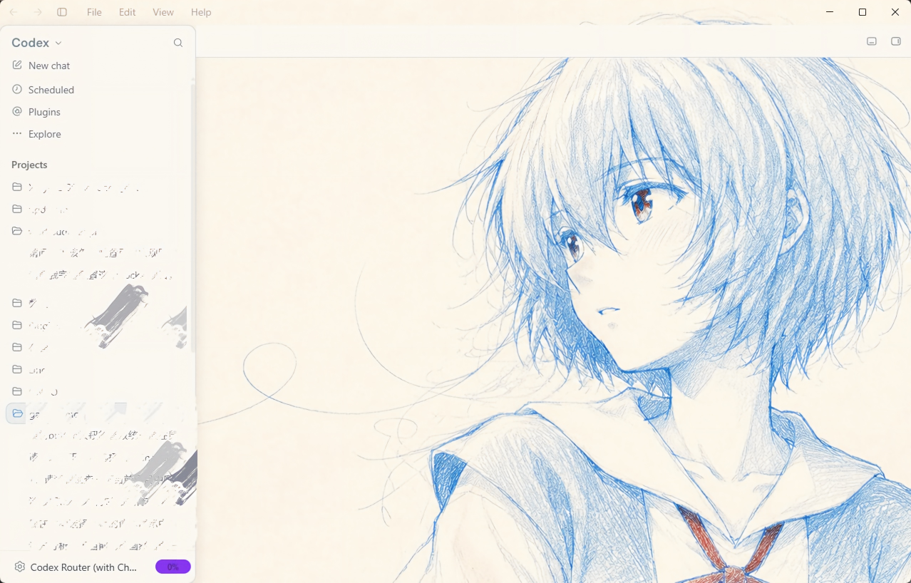
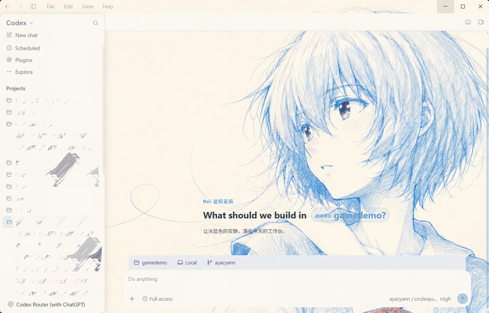

# Codex Dream Skin 1.5.18「对话区整块消失」修复

> 症状：装上 Dream Skin 后打开 Codex，**整个对话区（正文 + 输入框）变成一片壁纸**，同时 Dream Skin 自己弹出黑底提示「**显示校验失败**」。
>
> 适用：Codex 桌面版 `26.924.*` + Codex Dream Skin `1.5.18`。
> 本仓库给出**根因**、**可直接覆盖的修好的 `dream-skin.css`**，以及**手动改法 + 自查脚本**。

同一台机器、同一主题（Rei-蓝铅素描）、同一窗口尺寸（1280×820）的前后对比：

| 出故障：主内容区整块消失 | 修复后：首页与输入框正常 |
| :---: | :---: |
|  |  |
| 侧边栏和壁纸都正常，只有主内容区被打空 | 项目工具条与输入框都回来了 |

---

## 1. 症状与判定

对照上图左：**侧边栏在、壁纸在，唯独主内容区什么都没有**，输入框也一起消失。此时用 `Ctrl+Shift+I` 或本文末尾的探针脚本，会看到：

| 观测点 | 出故障时 | 正常时 |
|---|---|---|
| `[data-app-shell-main-content-top-fade]` 节点尺寸 | **0 × 0** | 1004 × 737（随窗口） |
| `[role="main"]`（首页） | 0 × 0 | 1004 × 738 |
| `[data-codex-composer-root]`（输入框） | 0 × 0，不可见 | 736 × 98，`visible: true` |
| 侧边栏 | 正常 | 正常 |
| Dream Skin 自检 `verify.log` | `structurePass: false` / `composer.visible: false` | 均为 `true` |

特征：**只有主内容区被打空，侧边栏和壁纸都好好的**，而且 Dream Skin 会自己报「显示校验失败」——因为它的自检就是靠量这几个节点的尺寸。

---

## 2. 根因

### 2.1 一句话

Codex 26.924 把 `data-app-shell-main-content-top-fade` 这个属性**从「渐变节点」改成了「状态枚举」，并且挂到了整条路由的内容帧上**；Dream Skin 的老规则按「属性存在就隐藏」把它 `display: none !important` 掉了，于是整条路由连同对话正文和输入框一起坍缩成 0×0。

### 2.2 展开

Dream Skin 里那条规则（`engine/assets/dream-skin.css`）：

```css
html[data-dream-skin="active"][data-dream-art-wide="true"] main:is(...)
  :is(.app-shell-main-content-top-fade,
      [data-app-shell-main-content-top-fade],   /* ← 26.924 里这个已经是状态枚举 */
      [class*="_MainContentTopFade_"]) {
  display: none !important;                     /* ← 致命的一行 */
  background: transparent !important;
}
```

这条规则的**本意**是「在应用了壁纸（art-wide）时，把顶部那块白色渐变压掉，好让壁纸从顶栏一直连到内容」。它当年是对的，因为 26.924 之前：

- 顶部渐变确实是**一个独立的绝对定位小条**，类名/属性就长这样；
- 把它 `display: none` 只影响那一层 16px 高的渐变，不会碰到内容。

26.924 之后语义变了：

1. 真正的渐变层挪到了子节点 `_MainContentTopFade_`（16px 高，绝对定位）；
2. `data-app-shell-main-content-top-fade` 变成了**路由内容帧自己的状态标记**，取值是 `visible` / `full-bleed`，用来告诉原生代码「当前滚动位置要不要显示顶部渐隐」；
3. 而这个带着状态标记的节点，**恰好包着整条路由的内容**——首页的 hero 和推荐、对话页的 `.thread-scroll-container`、以及底部的 composer 全在里面。

实测（出故障时）：

```
[data-app-shell-main-content-top-fade]  →  276,83  1004 × 737   display: none   ← 整条路由
  ├─ .thread-scroll-container                1004 × 0
  └─ [data-codex-composer-root]              0 × 0
```

所以 `display: none !important` 不是「压掉一条渐变」，而是**把整个页面主体删了**。因为 `!important` 且命中层级很高，Codex 原生样式救不回来——这也是为什么症状是「干干净净只剩壁纸」，而不是「内容挤在一起」。

---

## 3. 修复

### 方法 A：直接覆盖（推荐，30 秒）

本目录的 `dream-skin.css` 就是改好的文件（Dream Skin 1.5.18 引擎 CSS + 6 处修复）。

1. 关掉 Codex 和 Dream Skin；
2. 把本目录的 `dream-skin.css` 覆盖到：

   ```
   %LOCALAPPDATA%\CodexDreamSkin\engine\assets\dream-skin.css
   ```

3. 重新打开 Dream Skin（它会重新注入），再打开 Codex。

> 只是想留个后路：覆盖前先把原文件另存一份，日后 Dream Skin 更新后好做 diff。

### 方法 B：手动改 6 处

用编辑器打开 `%LOCALAPPDATA%\CodexDreamSkin\engine\assets\dream-skin.css`，按下表**原位替换**（不要追加到文件末尾，避免优先级混乱）。

#### 修复 1（根因）：不要再对状态枚举节点 `display: none`

```diff
 html[data-dream-skin="active"][data-dream-art-wide="true"] main:is(.main-surface, [data-app-shell-main-surface], [class*="_MainContentSurface_"])
-  :is(.app-shell-main-content-top-fade, [data-app-shell-main-content-top-fade], [class*="_MainContentTopFade_"]) {
-  display: none !important;
+  :is(.app-shell-main-content-top-fade, [class*="_MainContentTopFade_"]) {
   background: transparent !important;
+  background-image: none !important;
 }
```

要点：把 `[data-app-shell-main-content-top-fade]` 从选择器里**去掉**（它现在是状态枚举），删掉 `display: none`，改成清 paint。只清 paint 就足以让壁纸连到顶部，而且永远不会再打空页面。

#### 修复 2：底部渐隐条少了一个类名

26.924 的滚动渐隐丢掉了 `h-full`，尾部签名从 `…bottom-0 h-full bg-gradient-to-t from-surface via-surface` 变成 `…bg-gradient-to-t from-surface via-surface`，老规则匹配不上，于是输入框上方压着一条不透明的 `surface` 色横带。给同一组规则**补一个选择器**：

```diff
 html[data-dream-skin="active"] main:is(...):not(:has([role="main"]))
   [class~="pointer-events-none"][class~="bottom-0"][class~="h-full"][class~="bg-gradient-to-t"][class~="from-surface"][class~="via-surface"],
+html[data-dream-skin="active"] main:is(...):not(:has([role="main"]))
+  [class~="pointer-events-none"][class~="bg-gradient-to-t"][class~="from-surface"][class~="via-surface"],
 html[data-dream-skin="active"] main:is(...):not(:has([role="main"]))
   [class~="pointer-events-none"][class~="-bottom-1"][class~="h-7"][class~="bg-gradient-to-t"][class~="from-surface"][class~="to-transparent"] {
   background: transparent !important;
   background-image: none !important;
 }
```

#### 修复 3：正文锚点不再是卡片，改成常驻扁平

```diff
-/* Streaming reasoning is not yet inside the final assistant message. Give it
-   one readable surface, then remove the nested decoration after finalization. */
 html[data-dream-skin="active"] .thread-scroll-container
   [data-response-annotation-conversation][data-response-annotation-target] {
   box-sizing: border-box;
   margin-block: 4px 10px !important;
-  padding: 14px 16px !important;
-  border: 1px solid rgb(var(--ds-muted-rgb) / .18) !important;
-  border-radius: 18px !important;
-  background:
-    linear-gradient(135deg, rgb(var(--ds-text-rgb) / .08), transparent 42%),
-    rgb(var(--ds-panel-rgb) / .46) !important;
+  padding: 0 !important;
+  border: 0 !important;
+  border-radius: 0 !important;
+  background: transparent !important;
   color: var(--ds-text) !important;
-  box-shadow:
-    0 10px 28px rgb(var(--ds-bg-rgb) / .18),
-    inset 0 1px rgb(var(--ds-text-rgb) / .14) !important;
-  backdrop-filter: blur(20px) saturate(125%) brightness(104%) !important;
+  box-shadow: none !important;
+  backdrop-filter: none !important;
 }
```

（紧跟在后面那条 `[data-local-conversation-final-assistant] …` 的规则可以留着，已经无害。）

#### 修复 4：工具结果节点同样扁平

```diff
 html[data-dream-skin="active"] .thread-scroll-container
   [data-local-conversation-item-target-ids] {
   box-sizing: border-box;
-  padding: 10px 12px !important;
-  border: 1px solid rgb(var(--ds-muted-rgb) / .16) !important;
-  border-radius: 14px !important;
-  background:
-    linear-gradient(135deg, rgb(var(--ds-text-rgb) / .06), transparent 46%),
-    rgb(var(--ds-panel-rgb) / .52) !important;
+  padding: 0 !important;
+  border: 0 !important;
+  border-radius: 0 !important;
+  background: transparent !important;
   color: rgb(var(--ds-text-rgb) / .94) !important;
-  box-shadow:
-    0 8px 22px rgb(var(--ds-bg-rgb) / .16),
-    inset 0 1px rgb(var(--ds-text-rgb) / .12) !important;
-  backdrop-filter: blur(18px) saturate(120%) brightness(102%) !important;
+  box-shadow: none !important;
+  backdrop-filter: none !important;
 }
```

#### 修复 5：输入光标用文字色，不要用强调色

```diff
 html[data-dream-skin="active"] .ProseMirror {
   color: var(--ds-text) !important;
-  caret-color: var(--ds-accent) !important;
+  caret-color: var(--ds-text) !important;
 }
```

强调色在花纹壁纸上几乎看不见，光标会「消失」。

#### 修复 6：设置页多出来的一层不透明 Electron 表面

在 `html[data-dream-skin="active"] article, [data-ds-part="message"] { border-radius: 16px; }` 之后插入：

```css
html[data-dream-skin="active"]:has([data-settings-panel-slug])
  main[data-app-shell-main-surface]
  [class~="electron:bg-surface"][class~="windows:rounded-tl-lg"] {
  background: transparent !important;
  border-radius: 0 !important;
}
```

务必保留 `:has([data-settings-panel-slug])` 这个前提：全局把 `.bg-surface` 透明化会连弹窗、下拉菜单和卡片一起弄没。

### 改完必须重新注入

CSS 是注入到 Codex 渲染进程内存里的，**改了磁盘文件不会自动生效**。二选一：

- 退出 Dream Skin 再打开（推荐）；
- 或者手动热加载一次：

  ```bash
  # browserId 每次 Codex 重启都会变，从 state.json 里取，不要写死
  NODE="$LOCALAPPDATA/CodexDreamSkin/engine/runtime/node/node.exe"
  ID=$(python -c "import json,os;print(json.load(open(os.environ['LOCALAPPDATA']+'/CodexDreamSkin/state.json'))['browserId'])")
  "$NODE" "$LOCALAPPDATA/CodexDreamSkin/engine/scripts/injector.mjs" --once \
    --port 9335 --browser-id "$ID" \
    --theme-dir "$LOCALAPPDATA/CodexDreamSkin/active-theme"
  ```

---

## 4. English summary

Codex Desktop `26.924.*` changed `data-app-shell-main-content-top-fade` from a gradient node into a **state enum** (`visible` / `full-bleed`) placed on the **route content frame** — the element that wraps the entire main content. Dream Skin's legacy rule still matched that attribute and applied `display: none !important`, collapsing the whole route (thread body + composer) to 0×0, which left nothing but the wallpaper and made Dream Skin's own readiness check report "verification failed".

Fix: drop that attribute from the selector and never touch `display` on it — clear the paint on the real `_MainContentTopFade_` overlay instead. Five more 26.924 adaptations (bottom fade lost its `h-full` signature, annotation/tool-result anchors moved onto the message body, caret used the accent colour, an extra opaque Electron surface on Settings) are in section 3. `dream-skin.css` in this folder is the ready-to-use patched file.
